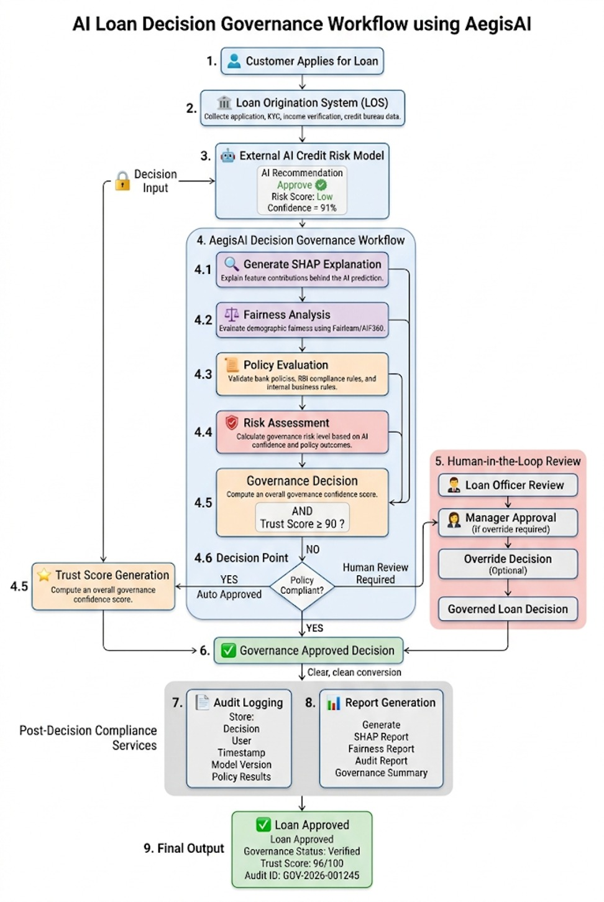
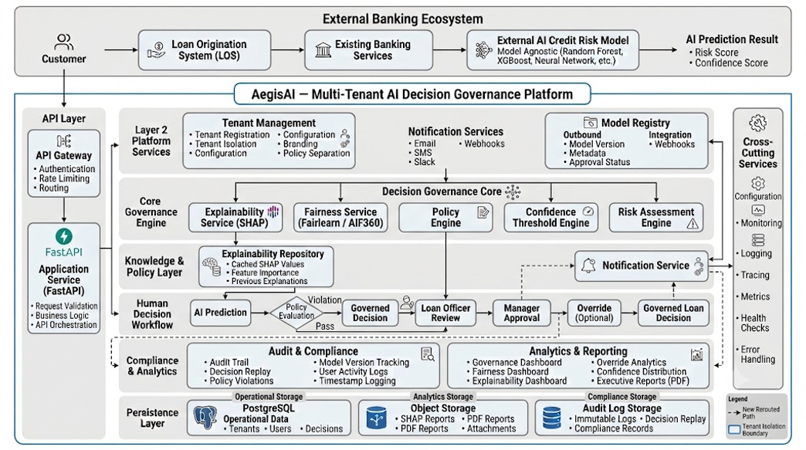
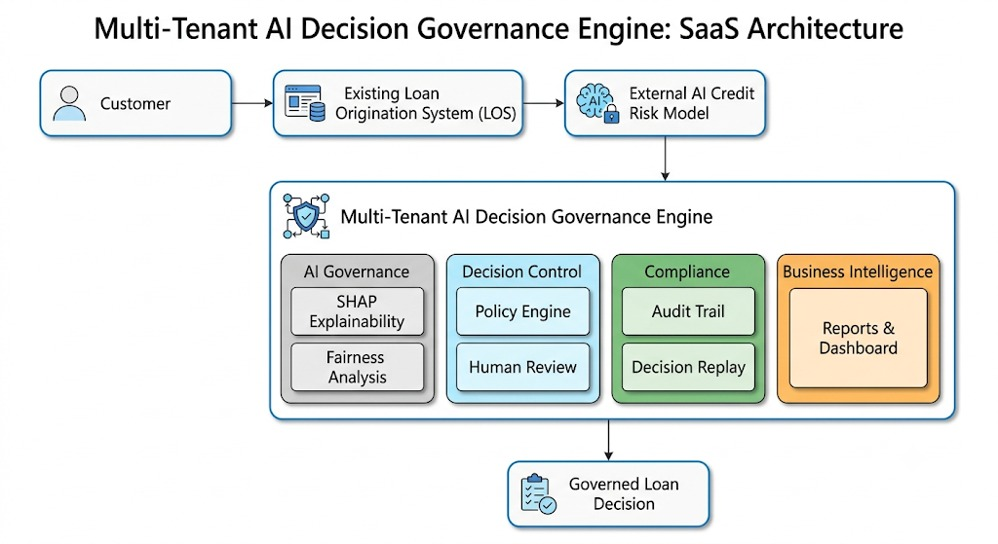

# AegisAI

> AI Governance Platform for Explainable, Auditable and Policy-Compliant FinTech Lending Decisions

## Overview

AegisAI is an AI governance platform being developed as a final-year engineering project to improve transparency, explainability, accountability, and policy compliance in AI-assisted lending systems.

Rather than replacing machine learning models, AegisAI acts as a governance layer between AI predictions and final lending decisions.

---

## Problem Statement

Financial institutions increasingly rely on AI models for credit assessment. While these models improve efficiency, they often operate as black boxes, making regulatory compliance and decision explainability difficult.

AegisAI addresses these challenges through governance, policy validation, explainability, audit logging, and human review workflows.

---

## Objectives

- Improve AI transparency
- Support explainable lending decisions
- Enforce policy-based validation
- Maintain audit trails
- Enable human-in-the-loop review

---

## Planned Features

- Explainability Engine
- Policy Validation Engine
- Audit Logging
- Decision Dashboard
- Human Review Workflow
- Governance Reports
- REST API

---

## Technology Stack

**Backend**
- Python
- FastAPI

**Machine Learning**
- Scikit-learn
- Pandas

**Database**
- PostgreSQL

**Frontend**
- React

---

## Repository Status

This repository currently contains the design and architecture phase of the project. Implementation is under active development.

---

## Development Roadmap

- [x] Problem Definition
- [x] Literature Survey
- [x] System Design
- [ ] Backend Development
- [ ] Explainability Module
- [ ] Policy Engine
- [ ] Dashboard
- [ ] Deployment

## Local development Platform Super Admin provisioning

The first Platform Super Admin can be provisioned only by a trusted local
maintainer using the one-shot CLI. It is not an API endpoint and does not
assign a Tenant Admin or Reviewer role. The command requires explicit
development opt-in, an existing absolute SQLite database path, and typing the
exact displayed path before it proceeds. It refuses a production environment
or an already-authorized Platform Super Admin.

After reviewing `app/provision_platform_admin.py` and taking a backup of the
intended database, run from the repository root in PowerShell:

```powershell
$env:AEGISAI_ENV = "development"
$env:AEGISAI_ALLOW_LOCAL_PLATFORM_ADMIN_PROVISIONING = "I_ACKNOWLEDGE_LOCAL_DEVELOPMENT_ONLY"
$env:AEGISAI_DB_PATH = (Resolve-Path ".\aegisai.db").Path
$env:AEGISAI_PHONE_ENCRYPTION_KEY = (& .\.venv\Scripts\python.exe -c "from cryptography.fernet import Fernet; print(Fernet.generate_key().decode())").Trim()
$env:AEGISAI_SMS_PROVIDER = "twilio"
$env:AEGISAI_TWILIO_ACCOUNT_SID = "<Twilio account SID>"
$env:AEGISAI_TWILIO_AUTH_TOKEN = "<Twilio auth token>"
$env:AEGISAI_TWILIO_FROM_NUMBER = "+15555550100"
.\.venv\Scripts\python.exe -m app.provision_platform_admin
```

The CLI sends an OTP to the supplied E.164 mobile number and requires the
operator to verify it before account creation. It then prompts for the
maintainer name, account email, and password (hidden input); it never accepts
the password as a command-line argument. The phone number is stored encrypted
and indexed by a keyed digest. The user, platform-admin marker, and audit event
are written in one transaction. To securely enroll or replace the verified
number on an existing account that lacks one, run
`python -m app.provision_platform_admin --enroll-phone` with the separate
`AEGISAI_ALLOW_PLATFORM_ADMIN_PHONE_ENROLLMENT=I_ACKNOWLEDGE_PRIVILEGED_ACCOUNT_PHONE_UPDATE`
opt-in, the absolute database path, and exact path confirmation. On SQLite deployments, this procedure can target the configured production
SQLite database and requires successful SMS verification of the new number; it
revokes that account's sessions. The current provisioning CLI is SQLite-only
and cannot target a PostgreSQL `DATABASE_URL`.

```powershell
$env:AEGISAI_ENV = "production"
$env:AEGISAI_ALLOW_PLATFORM_ADMIN_PHONE_ENROLLMENT = "I_ACKNOWLEDGE_PRIVILEGED_ACCOUNT_PHONE_UPDATE"
$env:AEGISAI_DB_PATH = (Resolve-Path ".\aegisai.db").Path
$env:AEGISAI_PHONE_ENCRYPTION_KEY = "<the configured production Fernet key>"
$env:AEGISAI_SMS_PROVIDER = "twilio"
$env:AEGISAI_TWILIO_ACCOUNT_SID = "<Twilio account SID>"
$env:AEGISAI_TWILIO_AUTH_TOKEN = "<Twilio auth token>"
$env:AEGISAI_TWILIO_FROM_NUMBER = "+15555550100"
.\.venv\Scripts\python.exe -m app.provision_platform_admin --enroll-phone
Remove-Item Env:AEGISAI_ALLOW_PLATFORM_ADMIN_PHONE_ENROLLMENT
```
There is no public Super Admin registration or phone-update route.

For production SMS delivery set `AEGISAI_ENV=production`,
`AEGISAI_SMS_PROVIDER=twilio`, and the three Twilio variables above in the
server's secret manager. No provider is bundled as a successful fallback:
missing or failed delivery blocks recovery and reports an error. The test-only
provider requires both `AEGISAI_ENV=development` and
`AEGISAI_ENABLE_TEST_OTP=true`; it returns a clearly labeled test code and is
refused when any production environment marker is set. Never enable it in a
deployed environment.

Set `AEGISAI_PHONE_ENCRYPTION_KEY` to a securely generated Fernet key on every
application instance before provisioning or phone recovery. Generate one with
`python -c "from cryptography.fernet import Fernet; print(Fernet.generate_key().decode())"`
and keep a protected backup; do not generate a fresh key each time you start
the server or run enrollment. Use the same key for the server and CLI. Losing
or rotating this key without re-encrypting the records makes enrolled numbers unavailable. Also configure a random,
high-entropy `AEGISAI_AUTH_SECRET` of at least 32 bytes for signed sessions
(for example, `python -c "import secrets; print(secrets.token_urlsafe(48))"`).
Production startup refuses the development signing-secret fallback. Clear development
provisioning opt-in variables after each administrative command:

```powershell
Remove-Item Env:AEGISAI_ALLOW_LOCAL_PLATFORM_ADMIN_PROVISIONING
```

## Database and frontend deployment configuration

Local development uses `AEGISAI_DB_PATH` or the repository's `aegisai.db` by
default; `AEGISAI_DB_PATH=:memory:` keeps the shared in-memory SQLite database
used by tests. Set `DATABASE_URL` to a PostgreSQL connection URL for deployment.
The backend uses the `psycopg` 3 driver. Startup creates missing PostgreSQL
tables from SQLAlchemy metadata, but does not migrate or alter existing
PostgreSQL tables. Review and apply any required schema changes through a
separately managed migration before deploying application changes.

Set `AEGISAI_CORS_ORIGINS` to a comma-separated list of exact frontend origins,
including scheme and optional port (for example, `https://app.example.com`).
Local Vite origins remain allowed. Wildcards, URL paths, and non-HTTP(S)
origins are rejected; do not use `*` with credentialed requests.

Platform Super Admins sign in at `/platform-admin/login`; tenant sign-in and
organization registration remain at `/login` and `/register`. Password
recovery sends a one-time code only to the verified number already on the
account. Password changes and recovery revoke existing signed sessions.

## 🏗️ System Architecture

### AI Decision Governance Workflow



---

### Platform Architecture



---

### SaaS Architecture


